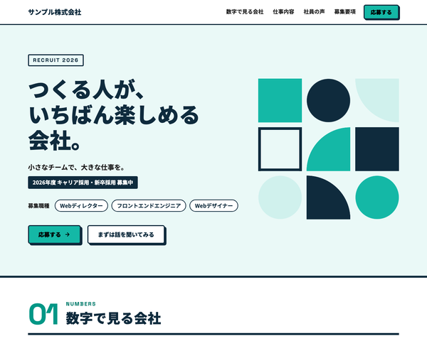

# BcLpRecruitTheme

baserCMS5用の、中小企業の採用のための1ページ LP（ランディングページ）テーマです。
数字で見る会社・仕事内容・社員の声・募集要項・選考の流れ・応募フォームまでを、
BurgerEditor のブロック操作と管理画面の設定だけで編集できます。

## 主な機能

- **1ページ LP**：トップの固定ページ1枚に、セクションを BurgerEditor のブロックで並べる構成
  - ヒーロー／数字で見る会社／私たちについて／仕事内容／社員の声／1日の流れ／働く環境・制度／募集要項／選考の流れ／よくある質問／応募（CTA）
  - セクションの追加・削除・並べ替えは、ブロック操作だけでできる。セクションの番号（01, 02 …）は自動で振られる
- **ページ内ナビの自動生成**：大見出しブロックの「ID設定」に英字（例 `jobs`）を入れると、ヘッダーのナビに載る。
  見出しの上には ID から作った英字のラベル（`JOBS`）が出る
- **応募フォーム**：入力 → 確認 → 完了の3画面。履歴書・職務経歴書のファイル添付つき。項目は管理画面のメールフィールドで追加・並べ替えできる
  - 「まずは話を聞いてみる」ボタンから開くと、応募の種類で「カジュアル面談を希望する」が選ばれた状態になる
- **テーマ設定の4色**で全体の配色が変わる（メイン／サブ／リンク／ホバー）。どの色にしても文字が読みやすいよう、文字の濃さと白黒を自動で調整する。ロゴもテーマ設定で変更できる
- **初期データ**：見本サイト一式（`default`）と、最小構成（`empty`）
- レスポンシブ（PC／スマホ）、`prefers-reduced-motion` 対応

## 動作環境

- baserCMS5.4.2以上
  - 5.4.0・5.4.1 では、応募フォームのファイル添付が原因で送信できません（下記「制限事項」）
- BurgerEditor（BcBurgerEditor）プラグインが有効であること

## インストール

1. `plugins/BcLpRecruitTheme` に配置
2. 管理画面 > プラグイン管理 で BcBurgerEditor が有効になっていることを確認
3. 管理画面 > テーマ管理 で BcLpRecruitTheme を適用
4. 同じ画面で初期データ `default`（見本サイト）または `empty`（最小構成）を読み込む

> 初期データを読み込むと、ユーザー以外のデータ（固定ページ・メールフォーム・サイト基本設定など）は初期化されます。
> 運用中のサイトでは読み込まないでください。

## 使い方

### 編集できる場所

| 内容 | 編集する場所 |
|---|---|
| 本文（全セクション） | 固定ページ「トップページ」の BurgerEditor |
| ロゴ・配色 | テーマ設定 |
| ヘッダーのナビ | 本文の大見出しブロックの「ID設定」（自動で作られる） |
| ヘッダーの「応募する」ボタンのリンク先 | 自動（公開中の最初のメールフォーム） |
| フォームの説明文・完了メッセージ・項目 | メールフォームの設定・メールフィールド |
| フッター（会社名・所在地・問い合わせ先） | ウィジェットエリア「フッター」のテキストウィジェット |

### 本文ブロックの独自 class

ブロック設定の「独自class設定」に入れると、決まった見た目になります。
一覧と中身の書き方は `webroot/css/bge_style.css` の冒頭にあります。

| 独自 class | 使うブロック | 見た目 |
|---|---|---|
| `rc-blk--hero` | 画像右寄せ（テキスト回り込み無し） | ヒーロー（ラベル・タイトル・キャッチ・バッジ・職種タグ・ボタン2つ。画像が空なら図形の飾り） |
| `rc-blk--section` | 大見出し | セクション見出し（自動の番号＋ID 設定でナビと英字ラベル） |
| `rc-blk--nonav` | 大見出し（`rc-blk--section` と併用） | ナビに載せない |
| `rc-blk--numbers` | 2カラムテーブル | 数字で見る会社のタイル（内容欄の1行目の数字が大きくなる） |
| `rc-blk--about` | 画像右寄せ（テキスト回り込み無し） | 見出し＋本文と画像の2列 |
| `rc-blk--jobs` | 画像3列＋テキスト | 仕事内容のカード（「JOB 01」は自動） |
| `rc-blk--voices` | 画像3列＋テキスト | 社員の声のカード |
| `rc-blk--day` | 2カラムテーブル | 1日の流れ（タイムテーブル） |
| `rc-blk--perks` | 1カラムテキスト | 働く環境・制度のカード（アイコンは並び順で決まる） |
| `rc-blk--requirements` | 2カラムテーブル | 募集要項の表 |
| `rc-blk--steps` | 1カラムテキスト | 選考の流れ（番号付きリスト。「STEP 01」は自動） |
| `rc-blk--faq` | 1カラムテキスト | よくある質問（開閉式） |
| `rc-blk--cta` | 1カラムテキスト | 応募の見出しとリード（中央寄せ） |
| `rc-blk--cta-cards` | 2カラムテキスト | 応募・カジュアル面談の2枚のカード |
| `rc-blk--center` | 任意 | 中央寄せ |

ブロック設定の「背景色」は、テーマ色に置き換えています（ブルー＝メインの薄い色／グレー＝サブの薄い色／ピンク＝サブの濃い色）。

### 複数の場所に書かれている値を変えるとき

次の値は複数の場所に書かれているので、それぞれ直してください。

- **会社名**：私たちについて／募集要項／フッター（ウィジェット）／メールフォームの説明文・送信完了メッセージ・差出人名／テーマ設定のロゴの代替テキスト
- **募集職種**：ヒーローの職種タグ／仕事内容／募集要項／メールフィールド「応募職種」の選択肢
- **年度・募集中の表示**：ヒーローのラベルとバッジ

### 「まずは話を聞いてみる」ボタンのリンク先

`/entry/?type=44Kr44K444Ol44Ki44Or6Z2i6KuH44KS5biM5pyb44GZ44KL` のように、メールフォームの URL に
`?フィールド名=値` を付けると、その値が選ばれた状態でフォームが開きます（baserCMS のメールフォームの機能）。
値は baserCMS 独自の URL 用 base64（`+`→`_`、`/`→`-`、`=`→`.`）にします。
「応募の種類」の選択肢の文言を変えたときは、このリンクも作り直してください。

### 配色の例

初期色はティールです。テーマ設定の4色を次のように変えると、オレンジの配色になります。

| | 初期色（ティール） | 配色例（オレンジ） |
|---|---|---|
| メイン | `#14b8a6` | `#ff5a1f` |
| サブ | `#0f2b3d` | `#14213d` |
| リンク | `#0e8f82` | `#ff5a1f` |
| ホバー | `#0b6f65` | `#c94412` |

## 設定

### 履歴書・職務経歴書の添付

- 添付できる形式は PDF・Word・Excel（`pdf,doc,docx,xls,xlsx`）です。メールフィールドのオプション `fileExt` で変更できます
- 添付されたファイルは管理者宛てのメールに添付され、サーバーの `webroot/files/mail/limited/` に保存されます（外から直接は開けません）
- サイズの上限は、オプションの `maxFileSize`（初期値 5MB）と、サーバーの PHP の設定（`upload_max_filesize`・`post_max_size`）で決まります。サーバーの上限が小さい場合は、サーバー側の設定も確認してください

## 制限事項

- 会社名・職種などは各ブロックに直接書くため、変更時は複数の場所を直す必要があります（上記「複数の場所に書かれている値を変えるとき」）
- 「働く環境・制度」のアイコンは項目ごとに選べません。並び順で決まります（在宅・時計・本・ハート・PC・太陽 の6つを繰り返す）
- 初期データの「履歴書・職務経歴書」には、拡張バリデーション「ファイルサイズチェック」（`VALID_MAX_FILE_SIZE`）を付けています。
  baserCMS5.4.1 以前では、この設定があるとフォームが送信できません（[baserproject/basercms#4540](https://github.com/baserproject/basercms/issues/4540)）。
  5.4.1 以前で使う場合は、メールフィールド「履歴書・職務経歴書」の拡張バリデーションから「ファイルサイズチェック」を外してください

## 同梱物・外部リソース

| 名前 | 用途 | ライセンス |
|---|---|---|
| [jQuery](https://jquery.com/) 3.7.1（`webroot/js/vendor/`） | BurgerEditor の公開側スクリプト（地図・YouTube・画像ポップアップ）の動作に必要 | MIT |
| [Google Fonts](https://fonts.google.com/)（Noto Sans JP・Space Grotesk） | 本文・見出し・英数字のフォント（CDN から読み込み。同梱はしていない） | SIL Open Font License 1.1 |
| アイコン（`bge_style.css`・テンプレート内の SVG） | 制度・選考の流れ・FAQ などのアイコン | [Lucide](https://lucide.dev/) のアイコンをもとにしている（ISC License） |

## ライセンス

MIT License
